# 🖥️ Awesome GPU Drivers & macOS Hardware Support

<p align="center">
  
</p>

<p align="center">
  <a href="https://github.com/ishandutta2007/Awesome-Awesome-Awesome"></a>
  <a href="https://discord.gg/jc4xtF58Ve"></a>
  <a href="https://github.com/ishandutta2007/Awesome-GPU-Drivers-Macos-Hardware-Support/stargazers"></a>
  <a href="https://github.com/ishandutta2007/Awesome-GPU-Drivers-Macos-Hardware-Support/network/members"></a>
  <a href="https://github.com/ishandutta2007"></a>
</p>

---

## ⚡ Overview & SEO Highlights

Welcome to the definitive curated guide to **macOS GPU drivers, graphics acceleration, Hackintosh kexts, Apple Silicon reverse-engineered graphics stacks, Metal/Vulkan API translation layers, and remote cloud GPU workstations**.

Whether you are reviving legacy Mac hardware with **OpenCore Legacy Patcher (OCLP)**, configuring AMD Radeon GPUs via **WhateverGreen** or **NootedRed / NootRX**, bridging DirectX 12 and Vulkan to Apple Metal via **MoltenVK**, **DXMT**, or **Whisky**, or streaming remote NVIDIA GeForce RTX compute rigs to your MacBook via **GeForce NOW**, **Parsec**, and **Shadow PC**, this repository catalogs both top-tier commercial platforms and active open-source projects.

### 🔍 Quick Highlights
- 🍏 **macOS Legacy & Hackintosh Acceleration**: Kernel extensions and bootloader patches for AMD Polaris, Vega, Navi, Big Navi, and legacy NVIDIA Kepler/Web Drivers.
- ⚡ **Apple Silicon & Linux GPU Engineering**: Mesa AGX, Asahi Linux Vulkan/OpenGL drivers, and unified memory optimizations.
- 🎮 **DirectX & Vulkan to Metal Bridges**: Wine/CrossOver wrappers, DXVK/DXMT, and MoltenVK graphics translation.
- ☁️ **Cloud GPU Workstations**: High-performance virtual machines streaming low-latency GPU desktop environments directly to macOS.

---

## 📑 Table of Contents

- [📊 Sector Overview & Market Dynamics](#-sector-overview--market-dynamics)
- [☁️ SaaS/Hosted & Commercial Platforms](#️-saashosted--commercial-platforms)
- [💻 Open-Source GitHub Projects](#-open-source-github-projects)
- [📈 Star History](#-star-history)
- [🛠️ How to Contribute](#️-how-to-contribute)
- [💖 Support & Thank You](#-support--thank-you)
- [⚠️ Disclaimer](#️-disclaimer)

---

## 📊 Sector Overview & Market Dynamics

The global GPU Compute, Cloud Workstation & Graphics Driver Software market is valued at approximately **$18.5B–$24.0B+ in 2026**, expanding at a ~24%–30% CAGR driven by Apple Silicon Metal 3/4 graphics workloads, cloud GPU workstation streaming, and open-source Linux/macOS GPU enablement. 

While proprietary vendor driver suites (**NVIDIA App/GeForce Experience, AMD Adrenalin, Intel Arc Control**) and cloud GPU streaming (**GeForce NOW, Paperspace, Shadow**) exhibit **strong vendor consolidation**, the **macOS legacy/eGPU driver patching, Apple Silicon reverse-engineered Mesa/Vulkan, and DirectX-to-Metal translation ecosystems are overwhelmingly open-source driven** (`OpenCore Legacy Patcher`, `WhateverGreen`, `NootedRed`, `Asahi Linux`, `MoltenVK`, `DXMT`).

---

## ☁️ SaaS/Hosted & Commercial Platforms

*Sorted descending by company valuation / annual revenue scale.*

| Platform | Description | Company Scale (Valuation / Revenue) | Starting Paid Tier | Free Tier / Trial Limit |
| :--- | :--- | :--- | :--- | :--- |
| **[GeForce NOW (NVIDIA)](https://nvidia.com)** | Cloud RTX GPU streaming service delivering cloud-rendered Windows PC games natively onto macOS, Linux, and low-power laptops at up to 4K/120fps. | **Part of NVIDIA Corp.** (~$130B+ annual revenue; ~$3T+ market cap) | **$9.99 / month** ($49.99/6 mos Performance) or **$19.99 / month** ($99.99/6 mos Ultimate RTX 4080/5080) | **Forever Free Basic Tier** (Ad-supported **1-hour session limit** with standard queue access on native macOS & web clients) |
| **[NVIDIA GeForce Experience / NVIDIA App](https://nvidia.com)** | Official NVIDIA GPU driver manager, ShadowPlay recorder, Freestyle shader overlay, and cloud game-optimization profile utility for Windows PCs & cloud VMs. | **Part of NVIDIA Corp.** (~$130B+ annual revenue; ~$3T+ market cap) | **$0 / Free Proprietary Driver Suite** (Bundled free for all NVIDIA GeForce and RTX GPU owners) | **100% Free Forever** (Unlimited Game Ready & Studio driver updates, GPU tuning, and hardware video capture with zero fees) |
| **[AMD Software: Adrenalin Edition](https://amd.com)** | Official AMD Radeon GPU driver suite featuring AMD Link remote streaming, FSR upscaling, Radeon Anti-Lag, telemetry overlays, and overclocking tools. | **Part of AMD Inc.** (~$25B+ annual revenue; ~$220B+ market cap) | **$0 / Free Proprietary Driver Suite** (Bundled free for all AMD Radeon RX and Ryzen integrated GPU owners) | **100% Free Forever** (Unlimited driver updates, GPU clock/voltage tuning, performance metrics, and HYPR-RX presets) |
| **[Intel Arc Control / Graphics Software](https://intel.com)** | Official Intel Arc discrete and integrated GPU driver control panel featuring XeSS upscaling, telemetry overlays, and studio AV1 encoding tools. | **Part of Intel Corp.** (~$53B+ annual revenue; ~$100B+ public market cap) | **$0 / Free Proprietary Driver Suite** (Bundled free for all Intel Arc and Core Ultra GPU owners) | **100% Free Forever** (Unlimited Game On driver updates, real-time GPU telemetry, and fan/power tuning) |
| **[Parsec (Unity Technologies)](https://parsec.app)** | Ultra-low-latency GPU-accelerated remote desktop and workstation streaming app connecting macOS clients to remote NVIDIA/AMD GPU hosts. | **Part of Unity Technologies** (Acquired for $320M; ~$1.8B+ Unity annual revenue) | **$8.00 / month** billed annually ($9.99/mo monthly for Parsec Warp with 4:4:4 color & multi-monitor) | **Forever Free Personal Plan** (Unlimited 1080p/60fps hardware-accelerated remote GPU streaming on macOS, Windows & Linux) |
| **[Shadow PC (OVHcloud / Octave Klaba)](https://shadow.tech)** | Full cloud Windows 11 desktop with dedicated NVIDIA RTX GPUs streamed natively to macOS for running CUDA, DirectX 12, and Windows-only apps. | **Backed by Octave Klaba / OVHcloud** (~€1B+ OVHcloud group revenue) | **$19.99 / month** (Discovery tier) or **$32.99 – $49.99 / month** (Boost / Power RTX GPU tiers) | **No Perpetual Free Tier** (Paid subscription only; 14-day statutory money-back refund guarantee where applicable) |
| **[Paperspace (DigitalOcean)](https://paperspace.com)** | Cloud GPU virtual machines and Parsec-ready Windows/Linux GPU desktops offering on-demand NVIDIA RTX A4000/A6000 and H100 instances. | **Part of DigitalOcean** (Acquired for $111M; ~$780M+ DigitalOcean annual revenue) | **$0.51 / hour** (Pay-as-you-go hourly GPU compute + $7/mo static IP/storage; or Gradient Pro at $8/month) | **Forever Free Gradient CPU/GPU Tier** (Free 6-hour Jupyter notebook sessions on select free GPUs; cloud Windows GPU VMs billed hourly) |
| **[Boosteroid](https://boosteroid.com)** | Native macOS and browser cloud GPU gaming platform streaming Windows DirectX 12 titles at up to 4K/120fps without local GPU hardware. | **~$100M–$200M Est. Valuation** (~$20M–$40M est. ARR; rapid EU/US server expansion) | **€7.49 / month** billed annually (€89.89/yr) or **€9.89 / month** monthly for Ultra 4K | **No Perpetual Free Tier** (Free account enables latency and bitrate connection diagnostics on macOS prior to subscribing) |
| **[AirGPU](https://airgpu.com)** | Pay-as-you-go hourly cloud gaming and Parsec/Moonlight GPU workstation service letting Mac users spin up high-end RTX rigs by the hour. | **Bootstrapped Cloud GPU Provider** (Independent hourly cloud gaming VM platform) | **$0.65 / hour** (Pay-as-you-go compute rates from $0.65/hr to $1.20/hr based on GPU tier & cloud region) | **No Perpetual Free Tier** (Pay-per-hour model; no free trial; $5 minimum wallet deposit to provision VMs) |
| **[Display Driver Uninstaller — DDU (Wagnardsoft)](https://wagnardsoft.com)** | Industry-standard GPU driver removal utility cleanly purging leftover NVIDIA, AMD, and Intel registry keys, shader caches, and driver files. | **Independent Freeware Utility** (Maintained by Wagnardsoft; Patreon & ad supported) | **$0 / Freeware Utility** (Optional Patreon sponsorship for independent developer support) | **100% Free Forever** (Unlimited clean Safe-Mode uninstalls of NVIDIA, AMD, Intel, and Realtek drivers) |

---

## 💻 Open-Source GitHub Projects

*Sorted descending by GitHub star count. Each badge links directly to that repository's stargazers page.*

| Project | Stars | Category & Focus | Description |
| :--- | :--- | :--- | :--- |
| **[OpenCore Legacy Patcher](https://github.com/dortania/OpenCore-Legacy-Patcher)** | [](https://github.com/dortania/OpenCore-Legacy-Patcher/stargazers) | macOS GPU Driver & Metal Patcher | Python and Swift GUI patching Metal drivers (NVIDIA Kepler, AMD TeraScale/GCN, Intel HD Graphics) for unsupported Macs on macOS Big Sur through Sequoia. |
| **[NVIDIA Open GPU Kernel Modules](https://github.com/NVIDIA/open-gpu-kernel-modules)** | [](https://github.com/NVIDIA/open-gpu-kernel-modules/stargazers) | Kernel-Level GPU Drivers | Official open-source kernel modules for NVIDIA Turing, Ampere, Ada Lovelace, and Blackwell architectures, foundational for Linux and hybrid macOS virtualizations. |
| **[OpenCorePkg](https://github.com/acidanthera/OpenCorePkg)** | [](https://github.com/acidanthera/OpenCorePkg/stargazers) | UEFI Firmware & GPU Injector | Industry standard modular UEFI bootloader orchestrating ACPI device property injection, framebuffers, and GPU device routing for macOS. |
| **[Whisky](https://github.com/Whisky-App/Whisky)** | [](https://github.com/Whisky-App/Whisky/stargazers) | Apple Silicon Metal Wrapper | Modern SwiftUI frontend built on Wine and Apple's Game Porting Toolkit (D3DMetal) to run DirectX 11/12 graphics natively on macOS Apple Silicon. |
| **[Heroic Games Launcher](https://github.com/Heroic-Games-Launcher/HeroicGamesLauncher)** | [](https://github.com/Heroic-Games-Launcher/HeroicGamesLauncher/stargazers) | Graphics Launcher & Engine | Cross-platform Epic Games, GOG, and Amazon Games launcher featuring built-in macOS Crossover/Wine, Metal, and MoltenVK graphics translation management. |
| **[nvtop](https://github.com/Syllo/nvtop)** | [](https://github.com/Syllo/nvtop/stargazers) | GPU Process Monitor | Real-time CLI GPU telemetry and monitoring utility supporting NVIDIA, AMD, Intel, and Apple Silicon unified memory GPUs. |
| **[MoltenVK](https://github.com/KhronosGroup/MoltenVK)** | [](https://github.com/KhronosGroup/MoltenVK/stargazers) | Vulkan to Metal Layer | Khronos Group's official Vulkan Portability implementation mapping Vulkan 1.2+ graphics and compute APIs directly to Apple Metal on macOS and iOS. |
| **[CloverBootloader](https://github.com/CloverHackyColor/CloverBootloader)** | [](https://github.com/CloverHackyColor/CloverBootloader/stargazers) | Legacy UEFI & GPU Injector | Veteran macOS bootloader featuring legacy VBIOS injection, EDID overrides, and automated graphics card detection for older PC hardware. |
| **[nvidia-macos-driver](https://github.com/nullmoth/nvidia-macos-driver)** | [](https://github.com/nullmoth/nvidia-macos-driver/stargazers) | NVIDIA Web Driver Patcher | Automated utility to patch and enable NVIDIA Web Drivers on newer macOS versions (macOS Mojave, Catalina, and beyond) for Maxwell and Pascal GPUs. |
| **[WineskinServer](https://github.com/Gcenx/WineskinServer)** | [](https://github.com/Gcenx/WineskinServer/stargazers) | Wine & Metal Compatibility Engine | Porting tool to wrap Windows DirectX applications into standalone macOS application bundles with DXVK, D3DMetal, and MoltenVK. |
| **[Lilu](https://github.com/acidanthera/Lilu)** | [](https://github.com/acidanthera/Lilu/stargazers) | Kernel Extension Framework | Core macOS kernel extension patcher engine that powers WhateverGreen, AppleALC, and graphics driver memory hotpatching. |
| **[AppleALC](https://github.com/acidanthera/AppleALC)** | [](https://github.com/acidanthera/AppleALC/stargazers) | GPU HDMI/DP Audio Patch | Native macOS audio kernel extension patching HDMI/DisplayPort audio endpoints on discrete NVIDIA and AMD graphics cards without codec binary modifications. |
| **[WhateverGreen](https://github.com/acidanthera/WhateverGreen)** | [](https://github.com/acidanthera/WhateverGreen/stargazers) | Graphics Fixup Kext | Essential Lilu plugin providing comprehensive video patches, connector patching, DP/HDMI audio, backlight controls, and DRM fixes for AMD, Intel, and NVIDIA GPUs. |
| **[NootedRed](https://github.com/ChefKissInc/NootedRed)** | [](https://github.com/ChefKissInc/NootedRed/stargazers) | AMD Vega APU Driver Kext | Lilu plugin providing full hardware graphics acceleration for AMD Ryzen Vega iGPUs (Raven, Picasso, Renoir, Cezanne, Barcelo) on macOS. |
| **[radeontop](https://github.com/clbr/radeontop)** | [](https://github.com/clbr/radeontop/stargazers) | AMD GPU Utilization Monitor | Terminal utility reading utilization bus metrics, shader engines, and VRAM bandwidth on modern and legacy AMD Radeon graphic cards. |
| **[marazmista/radeon-profile](https://github.com/marazmista/radeon-profile)** | [](https://github.com/marazmista/radeon-profile/stargazers) | AMD Overclocking & Clocks | Qt GUI application monitoring clocks, fan profiles, power states, and thermals for ATi and AMD Radeon graphics hardware. |
| **[NootRX](https://github.com/ChefKissInc/NootRX)** | [](https://github.com/ChefKissInc/NootRX/stargazers) | AMD Navi 22/23 Driver Kext | Lilu plugin enabling native Metal acceleration and display pipeline support for unsupported AMD Radeon RX 6700 XT and RX 6600 series dGPUs. |

---

## 📈 Star History

[](https://www.star-history.com/#ishandutta2007/Awesome-GPU-Drivers-Macos-Hardware-Support&type=date&legend=top-left)

---

## 🛠️ How to Contribute

Contributions are welcome! Please follow these steps to add new resources or update existing data:

1. 🍴 **Fork** this repository.
2. 🌿 **Create a branch** for your feature or update:
   ```bash
   git checkout -b feat/add-new-gpu-driver
   ```
3. 📝 **Add your entry** in the appropriate section with correct markdown formatting, pricing details, and star badges.
4. 🚀 **Commit and Push**:
   ```bash
   git commit -m "Add [Project/Platform Name] to macOS GPU drivers list"
   git push origin feat/add-new-gpu-driver
   ```
5. 📬 **Submit a Pull Request** describing your additions and providing links to the official project or documentation.

---

## 💖 Support & Thank You

Thank you for exploring and supporting **Awesome GPU Drivers & macOS Hardware Support**! 

Maintaining and curating open-source hardware lists, graphics patches, and benchmarked tiers takes continuous research and testing. If this repository helped you enable graphics acceleration, set up an eGPU, or configure a cloud workstation:

- ⭐ **Star this repository** to help others discover it on GitHub.
- 🍴 **Fork and share** it with the Hackintosh, Mac gaming, and GPU engineering communities.
- ☕ **Support the maintainer**: Buy a coffee or become a sponsor at the **[Sponsor Dashboard](https://github.com/sponsors/ishandutta2007)**.

Your encouragement and contributions keep this directory accurate and up to date!

---

## ⚠️ Disclaimer

*Apple, macOS, Metal, Mac, MacBook, and Apple Silicon are trademarks of Apple Inc. NVIDIA, GeForce, CUDA, and RTX are trademarks of NVIDIA Corporation. AMD, Radeon, and Ryzen are trademarks of Advanced Micro Devices, Inc. Intel and Intel Arc are trademarks of Intel Corporation. This curated repository is an independent open-source documentation resource and is not affiliated with, sponsored by, or endorsed by Apple, NVIDIA, AMD, or Intel.*
